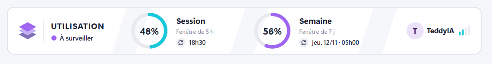

# teddy-mods

Quatre mods Claude Code :

- **context-weather** : la « météo » du contexte, c'est-à-dire le remplissage de la fenêtre de contexte (de Grand soleil à Orage).
- **usage-limits** : les limites d'usage sur 5 heures et sur 7 jours, avec leur heure de réinitialisation.
- **usage-forecast** : la prévision de la limite des 7 jours (rythme, pourcentage prévu au reset, marge), dans un panneau latéral.
- **turn-alert** : un toast, un son et une notification quand un tour long de Claude se termine.

`context-weather` et `usage-limits` ajoutent une bande au-dessus de la zone de prompt. `usage-forecast` ouvre un panneau à droite de la conversation, pour ne pas prendre de place en dessous. Sur l'application desktop, chaque bande et le panneau sont des cartes graphiques. Dans le terminal, ce sont des lignes de texte. Les mods ne dépendent pas du compte : ils affichent les limites du compte connecté.

Pour créer vos propres mods sans connaître le système, voir le **guide complet** [docs/guide-complet-mods-claude-code.pdf](docs/guide-complet-mods-claude-code.pdf) (source [.html](docs/guide-complet-mods-claude-code.html)) : installation, premier mod pas à pas, événements, affichage, données, réglages, tests, débogage, publication, pièges et aide-mémoire.

Pour l'essentiel en bref, voir le guide de deux pages [docs/guide-mods-claude-code.pdf](docs/guide-mods-claude-code.pdf) : ce qu'un mod peut faire, où il agit à l'écran, comment l'écrire, le tester et le partager. Sa source modifiable est [docs/guide-mods-claude-code.html](docs/guide-mods-claude-code.html) (impression en PDF depuis un navigateur, format A4).

## Installation

Le dépôt est privé : le compte GitHub doit y avoir accès, et l'ordinateur doit déjà pouvoir se connecter à GitHub avec git (clé SSH, ou `gh auth login` puis `gh auth setup-git`). L'installation ne demande pas d'identifiants.

### Méthode A : marketplace GitHub (recommandée)

Dans un terminal :

```bash
claude plugin install context-weather --marketplace Teddy57600/teddy-mods
```

```bash
claude plugin install usage-limits --marketplace Teddy57600/teddy-mods
```

```bash
claude plugin install usage-forecast --marketplace Teddy57600/teddy-mods
```

```bash
claude plugin install turn-alert --marketplace Teddy57600/teddy-mods
```

Dans une session Claude Code du terminal, `/plugin install context-weather --marketplace Teddy57600/teddy-mods` fait la même chose : répondez `y` pour ajouter le marketplace, puis choisissez la portée.

Dans l'application desktop : cliquez sur **+** à côté de la zone de prompt, puis **Plugins**, **Add marketplace** avec `Teddy57600/teddy-mods`, puis **Add plugin**.

Pour une mise à jour : augmentez `version` dans le `plugin.json` du mod concerné, poussez la modification sur GitHub, puis lancez `claude plugin update context-weather@teddy-mods` (ou `usage-limits@teddy-mods`, `usage-forecast@teddy-mods`, `turn-alert@teddy-mods`).

Pour désinstaller : `claude plugin uninstall context-weather@teddy-mods`.

N'utilisez pas la méthode B en même temps : chaque bande s'afficherait deux fois, et chaque alerte de fin de tour partirait deux fois.

### Méthode B : chargement direct des dossiers (développement)

Clonez le dépôt, par exemple dans `C:\Users\<login>\.claude\teddy-mods`, puis ajoutez ce bloc dans `C:\Users\<login>\.claude\settings.json`. Si le fichier contient déjà des réglages, ajoutez seulement la clé `env` à côté des autres. Sous Windows, les chemins sont séparés par `;` :

```json
{
  "env": {
    "CLAUDE_CODE_PLUGIN_DIRS": "C:\\Users\\<login>\\.claude\\teddy-mods\\context-weather;C:\\Users\\<login>\\.claude\\teddy-mods\\usage-limits;C:\\Users\\<login>\\.claude\\teddy-mods\\usage-forecast;C:\\Users\\<login>\\.claude\\teddy-mods\\turn-alert"
  }
}
```

Redémarrez ensuite l'application Claude. Avec cette méthode, une modification des fichiers est prise en compte sans réinstallation.

### Session distante (SSH) ou nouvel environnement

Les plugins sont installés **machine par machine**. Une session SSH de l'application desktop lit `~/.claude` du serveur, pas `C:\Users\<login>\.claude` du poste. Les mods installés sur le poste n'y apparaissent donc pas : `/reload-plugins` n'affiche que les plugins intégrés à l'application. Il faut les installer une fois sur chaque serveur ou nouvel environnement.

1. Sur le poste, relevez ce qui est installé :

   ```powershell
   Get-Content "$env:USERPROFILE\.claude\plugins\known_marketplaces.json"
   ```

   ```powershell
   (Get-Content "$env:USERPROFILE\.claude\settings.json" -Raw | ConvertFrom-Json) | Select-Object enabledPlugins, extraKnownMarketplaces | ConvertTo-Json -Depth 10
   ```

2. Sur le serveur, la commande `claude` n'est souvent pas dans le `PATH`, mais l'application y dépose sa propre CLI dans `~/.claude/remote/ccd-cli/<version>/` :

   ```bash
   CLI=$(ls -d ~/.claude/remote/ccd-cli/* | sort -V | tail -1)
   ```

   ```bash
   "$CLI" plugin marketplace add Teddy57600/teddy-mods
   ```

   ```bash
   for m in context-weather usage-limits usage-forecast turn-alert; do "$CLI" plugin install "$m@teddy-mods"; done
   ```

   ```bash
   "$CLI" plugin list
   ```

   Déclarer seulement les marketplaces et les plugins dans `settings.json` (`extraKnownMarketplaces`, `enabledPlugins`) ne télécharge rien dans une session déjà ouverte. Le serveur doit pouvoir cloner le dépôt (`gh auth login` puis `gh auth setup-git` sur le serveur).

3. **Les nouvelles sessions** chargent les mods. **Une session déjà ouverte** ne les charge qu'en partie avec `/reload-plugins` : `turn-alert` fonctionne, mais les bandes au-dessus du prompt n'apparaissent pas. Il faut relancer le processus de cette session. Relancer l'application desktop ne suffit pas, car les processus du serveur survivent, et le bouton d'arrêt d'une session n'interrompt que le tour en cours. Sur le serveur, terminez le processus d'une session **inactive**, en l'identifiant par son heure de démarrage :

   ```bash
   ps -eo pid,lstart,args | grep ccd-cli/ | grep -v grep
   ```

   ```bash
   kill -TERM <pid>
   ```

   Rouvrez ensuite la session et envoyez-lui un message : l'application relance un processus neuf qui charge les mods, et l'historique est conservé.

### Mise à jour automatique (Linux, macOS, SSH)

`scripts/maj-plugins-claude.sh` rafraîchit toutes les marketplaces, met à jour **chaque plugin installé** et affiche les versions qui ont changé. Il trouve seul la CLI (`claude` dans le `PATH`, sinon celle de `~/.claude/remote/ccd-cli/`). Installation une fois par machine :

```bash
sudo install -m 755 scripts/maj-plugins-claude.sh /usr/local/bin/maj-plugins-claude
```

Puis, après chaque nouvelle version poussée sur GitHub :

```bash
maj-plugins-claude
```

`maj-plugins-claude -n` montre ce qui serait mis à jour sans rien installer. Une mise à jour n'est détectée que si `version` a augmenté dans le `plugin.json` du mod. Elle s'applique aux nouvelles sessions. Pour les sessions déjà ouvertes, le script liste leurs processus sans les arrêter (voir le point 3 ci-dessus).

## Thème

`context-weather`, `usage-limits` et `usage-forecast` ont chacun un réglage `theme` pour leur carte graphique :

- `auto` (par défaut) : la carte suit le thème clair ou sombre de l'affichage, et reste sombre si l'affichage ne l'indique pas.
- `sombre` : toujours sombre.
- `clair` : fond crème et textes foncés.

Le réglage se change dans le menu `/config` de Claude Code (une ligne par mod), ou dans `C:\Users\<login>\.claude\settings.json`. Si le fichier contient déjà une clé `pluginConfigs`, ajoutez-y seulement ces lignes :

```json
{
  "pluginConfigs": {
    "context-weather@teddy-mods": { "options": { "theme": "clair" } },
    "usage-limits@teddy-mods": { "options": { "theme": "clair" } },
    "usage-forecast@teddy-mods": { "options": { "theme": "clair" } }
  }
}
```

Avec la méthode B, les clés sont les noms des mods, sans `@teddy-mods`. Dans le terminal, les bandes restent du texte qui suit déjà le thème du terminal.

## Style

Les trois mêmes mods ont aussi un réglage `style` :

- `classique` (par défaut) : la carte d'origine, à jauges horizontales.
- `anneaux` : une carte épurée avec un logo en couches, une pastille d'état, des anneaux de progression et le compte à droite.



En style `anneaux` :

- **usage-limits** montre un anneau pour la session (5 h, cyan) et un pour la semaine (7 j, violet), avec leur heure de remise à zéro ;
- **context-weather** montre la part occupée et la part encore libre de la fenêtre de contexte, en jetons ;
- **usage-forecast** montre l'utilisé et le prévu au reset, puis les quatre valeurs et le verdict.

Un anneau passe au rouge à 100 % (orange puis rouge quand le contexte dépasse 70 % puis 85 %). Le réglage `theme` s'applique aussi : en `clair`, fond blanc ; en `sombre`, fond bleu nuit. Il se change dans `/config` ou dans `settings.json`, à côté de `theme` :

```json
"usage-limits@teddy-mods": { "options": { "theme": "auto", "style": "anneaux" } }
```

Le terminal garde son affichage texte quel que soit le style.

## Prévision hebdo (usage-forecast)

Le panneau prolonge le rythme moyen de la semaine jusqu'à la remise à zéro de la limite des 7 jours :

- **en tête** : le verdict (Large marge, Confortable, À surveiller, Juste, Limite avant le reset) et le pourcentage prévu au reset ;
- **la jauge** : la part utilisée, puis en hachures la part prévue d'ici le reset, avec la date du reset ;
- **rythme** : la consommation moyenne par jour et par heure depuis le début de la semaine ;
- **reset dans** : le temps restant avant la remise à zéro, et le temps écoulé ;
- **marge** : combien de fois plus vite il faudrait consommer pour atteindre la limite avant le reset (sous ×1, la limite arrive avant) ;
- **limite dans** : quand la limite serait atteinte au rythme actuel, en rouge si c'est avant le reset.

La carte prend la largeur du panneau : en fiche verticale quand il est étroit, sur une ligne de quatre valeurs quand il est large. Le panneau s'ouvre à chaque session, à droite de la conversation quand la place le permet. S'il a été fermé, `/usage-forecast` le rouvre. La prévision suppose un rythme régulier : dans les trois premières heures de la semaine, elle attend d'avoir assez de recul.

## Réglages de turn-alert

Par défaut, l'alerte part pour les tours de 60 secondes et plus, ni pour les sous-agents ni pour un tour que vous avez interrompu. Dans une session :

- `/turn-alert` : affiche les réglages
- `/turn-alert 30` : alerte dès 30 secondes
- `/turn-alert son off` (ou `on`) : coupe ou remet le carillon
- `/turn-alert notif off` (ou `on`) : coupe ou remet la notification système
- `/turn-alert test` : déclenche une alerte d'essai

Les réglages sont conservés d'une session à l'autre. Le toast s'affiche toujours. Sous Windows, le carillon est joué par PowerShell ; ailleurs, par le lecteur audio de Claude Code (`afplay` sur macOS, aucun sous Linux).

## Personnalisation

Dans `hooks/register.tsx` des mods à carte (bandes et panneau) :

- `BRAND` : le nom affiché à droite de la carte (`TeddyIA`).
- `forecast` (context-weather), `level` (usage-limits) et `levelOf` (usage-forecast) : seuils, libellés et couleurs de chaque niveau, en sombre et en clair.
- `SURFACE` : les couleurs fixes de la carte (fond, textes, jauges), en sombre et en clair.
- `hooks/anneaux.ts` : les couleurs (`HUE`, `SURFACE`) et les éléments du style `anneaux`. Ce fichier est identique dans les trois mods : le modifier partout à la fois.

## Remarques

- `usage-limits` se met à jour à chaque mesure du moteur (après chaque réponse, et dès qu'une fenêtre bouge d'un point). Au début d'une session, avant la première réponse, il reprend la dernière mesure connue, marquée « Dernière mesure », tant que la fenêtre n'est pas réinitialisée. Il reste vide sans abonnement Claude (clé API, passerelle d'entreprise).
- Les heures de réinitialisation suivent le fuseau horaire de la machine.
